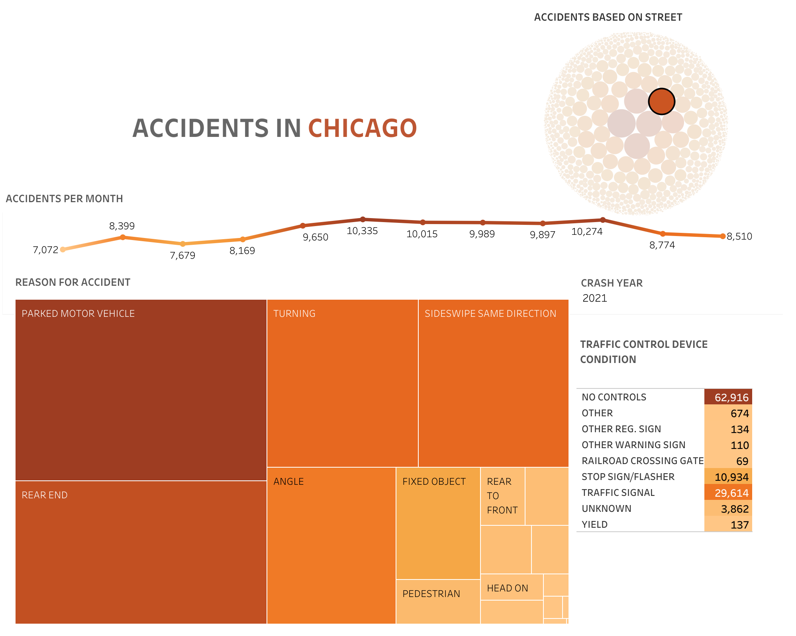

# 🚦 Chicago Traffic Crash Analytics

End to end analysis of **798K City of Chicago crash records (48 fields)**, from data cleaning in Python to an interactive Tableau dashboard, to find when, where, and why crashes happen.

### 🔗 [View the Live Dashboard](https://public.tableau.com/app/profile/supriya.kumari.kushwaha/viz/Traffic_crashes_in_chicago/FINALDASHBOARD)

---

## 🔍 Key Insights

| | Insight |
|---|---|
| ⚠️ | Top known causes: **failing to yield right of way (87.6K)** and **following too closely (77.9K)** |
| 🚗 | **Rear end** crashes led from 2015 to 2019. **Parked vehicle** crashes have led since 2020 |
| 🚦 | In 2021, **58% of crashes** happened where **no traffic control** was present |
| 🕓 | Crashes peak between **2 PM and 6 PM**, during the afternoon commute |
| 📅 | 2021 monthly crashes ranged from **7.1K in January** to **10.3K in June** |

## 🧹 Data Preparation

- Dropped **11 columns with over 50% missing values**
- Removed rows missing injury fields, **retaining 99.8% of records** (796.5K)
- Imputed remaining gaps in street, report type, and location fields
- Parsed timestamps and derived year, month, and hour for trend analysis

## 📊 Analysis

- **Trends:** crashes by year, month, day of week, and hour
- **Root causes:** primary and secondary contributory causes, crash type by year
- **Conditions:** weather, lighting, road surface, road defects, and traffic control devices
- **Severity:** injury distribution and correlation analysis across injury and crash fields

## ⚖️ Analytical Notes

- Crash counts rise sharply from 2015 to 2018 largely because the city's electronic crash reporting **rolled out citywide in late 2017**, not because crashes truly tripled. Year over year comparisons are reliable from 2018 on.
- **2024 is a partial year** (3.7K records) and is excluded from trend conclusions.
- The largest cause category is **"Unable to Determine" (309K)**, so cause rankings reflect known causes only.

## 🛠️ Tools

Python (pandas, NumPy, Matplotlib, Seaborn, Plotly) · Tableau

